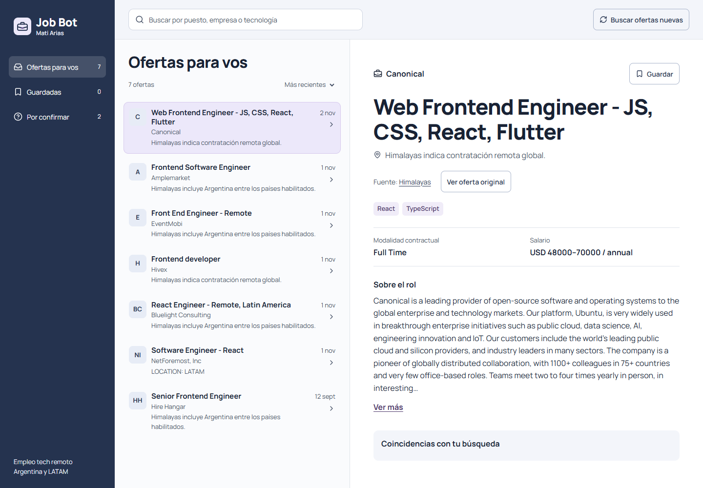

# Job Bot

Bandeja personal de ofertas remotas de frontend y software engineering desde Argentina. Podés buscar y guardar vacantes, revisar qué requisitos conviene confirmar y abrir la publicación original.

**[Abrir Job Bot en producción](https://job-bot-mati.vercel.app/)**



## Cómo funciona

React y TanStack Query consultan a NestJS, que lee el catálogo público de Supabase. **Buscar ofertas nuevas** requiere una clave de actualización. NestJS consulta Get on Board e Himalayas, aplica reglas de afinidad y elegibilidad, y guarda los resultados. La lista se actualiza cuando termina. Las ofertas guardadas se conservan en el navegador.

LinkedIn se usa por separado mediante sus alertas oficiales. La búsqueda web usa reglas y se ejecuta al pulsar el botón. La CLI sigue disponible para calibrar y probar el matching, con OpenAI opcional.

## Desarrollo local

Con Node.js 24 LTS, ejecutá esto desde la raíz del repositorio:

```powershell
npm.cmd ci
npm.cmd run dev:api
```

En otra terminal, desde la misma carpeta:

```powershell
npm.cmd run dev:web
```

Abrí [http://localhost:5173](http://localhost:5173). Podés explorar la bandeja con ofertas de ejemplo sin configurar Supabase.

## Catálogo real y despliegue

1. En Supabase, aplicá los archivos de `supabase/migrations/` en orden. En el `.env` local, configurá `SUPABASE_URL` y `SUPABASE_PUBLISHABLE_KEY` para leer el catálogo.
2. Para usar el botón, configurá también `SUPABASE_SECRET_KEY`, `JOB_BOT_DOCUMENTED_YEARS` con tus años de experiencia documentados y `JOB_REFRESH_TOKEN` con una clave propia. Podés generar esta última con `node -p "require('node:crypto').randomBytes(32).toString('base64url')"`. Ingresá esa clave en la bandeja y guardá ambas claves privadas fuera de Git.
3. En Vercel, usá dos proyectos con Node.js 24 y acceso a los archivos compartidos del monorepo. En el proyecto NestJS (`apps/api`), cargá las variables anteriores y `WEB_ORIGIN` con la URL pública de la web. En el proyecto Vite (`apps/web`), configurá `VITE_API_BASE_URL` con la URL pública de la API. Usá los orígenes sin barra final y guardá las claves privadas como secretos del proyecto API.

El catálogo conserva sus ofertas si ambos portales fallan. La búsqueda permite un inicio cada dos minutos. El contador del resultado incluye altas y actualizaciones.

## Código y pruebas

- `apps/web` contiene la bandeja en React y Vite.
- `apps/api` expone `GET /api/jobs` y `POST /api/jobs/refresh` con NestJS.
- `packages/job-search` reúne las fuentes y las reglas. `packages/contracts` define los tipos compartidos.
- `apps/cli` contiene `jobs:scan` y `jobs:sync`. Para usar la CLI, copiá `profile.example.json` a `profile.local.json` y completá tu perfil sin datos de contacto.

```powershell
npm.cmd test
npm.cmd run typecheck
npm.cmd run build:api
npm.cmd run build:web
npx.cmd playwright install chromium
npm.cmd run test:e2e
```
